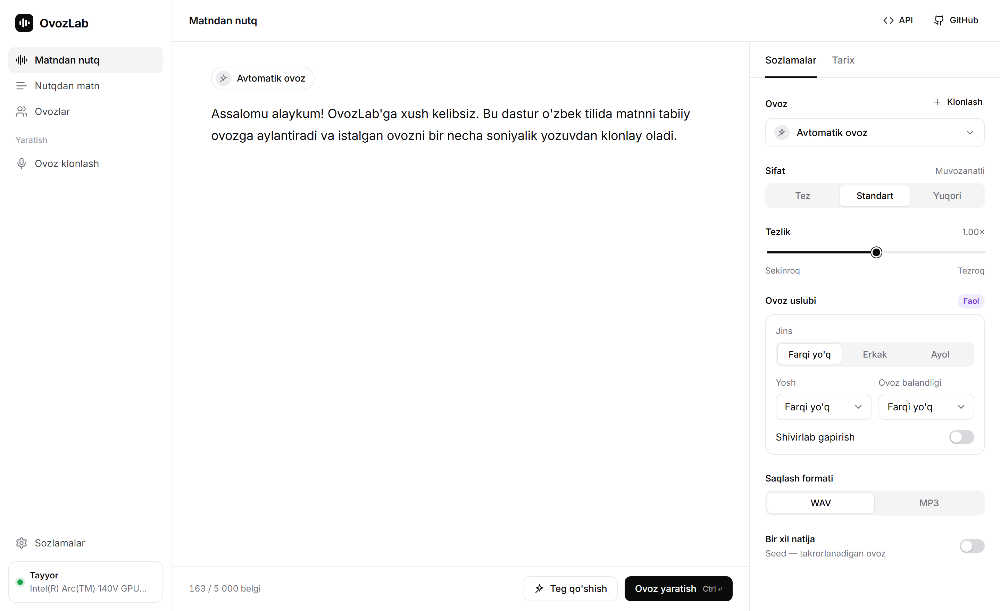

<p align="center">
  
</p>

<h1 align="center">OvozLab</h1>

<p align="center">
  <b>O'zbek tilida tabiiy ovoz. Sizning kompyuteringizda.</b><br>
  Matndan nutq, ovoz klonlash va nutqdan matn — ochiq kodli, bepul va internetsiz.
</p>

<p align="center">
  <a href="https://github.com/uz4studiosuz/OvozLab/releases/latest/download/OvozLab-Setup.exe"></a>
</p>

<p align="center">
  <a href="https://github.com/uz4studiosuz/OvozLab/releases/latest"></a>
  <a href="https://github.com/uz4studiosuz/OvozLab/releases"></a>
  <a href="LICENSE"></a>
  
  
</p>

<p align="center">
  <picture>
    <source media="(prefers-color-scheme: dark)" srcset="docs/screenshot-dark.png">
    
  </picture>
</p>

---

## Mundarija

- [Imkoniyatlar](#imkoniyatlar)
- [O'rnatish](#ornatish)
- [Foydalanish](#foydalanish)
- [Tezlik](#tezlik)
- [Dasturchilar uchun](#dasturchilar-uchun)
- [API](#api)
- [Ko'p so'raladigan savollar](#kop-soraladigan-savollar)
- [Muammolarni hal qilish](#muammolarni-hal-qilish)
- [Loyiha tuzilmasi](#loyiha-tuzilmasi)
- [Hissa qo'shish](#hissa-qoshish)
- [Litsenziya va minnatdorchilik](#litsenziya-va-minnatdorchilik)

## Imkoniyatlar

| | |
|---|---|
| 🗣️ **Matndan nutq** | O'zbekcha matnni tabiiy ovozga aylantiradi. 5 000 belgigacha matn qabul qiladi, uzun matnni o'zi bo'laklarga bo'ladi. Tezlik, sifat va format (WAV/MP3) sozlanadi. |
| 🎙️ **Ovoz klonlash** | 5–15 soniyalik yozuvdan istalgan ovozni nusxalaydi. Ekranda o'qish uchun matn chiqadi: **oddiy, quvnoq, jiddiy, g'amgin, hikoyachi** ohangida. |
| 📝 **Nutqdan matn** | 60 daqiqagacha audio yoki videoni o'zbekcha matnga o'giradi. Natijani **TXT** yoki **SRT subtitr** qilib saqlash mumkin. |
| 🎛️ **Ovoz uslubi** | Jins, yosh (bola, yosh, o'rta yosh, keksa), ovoz balandligi va shivirlash. Uslub bir marta yaratilib saqlanadi, shuning uchun har safar bir xil ovoz chiqadi. |
| 🎭 **Kayfiyat** | Oddiy, quvnoq, g'amgin, jiddiy, hikoyachi. Ovozning kayfiyatli yozuvi bo'lsa, haqiqiy kayfiyat shundan olinadi; aks holda tezlik va ohang moslanadi. |
| 🔵 **Ko'rgazma rejimi** | To'liq ekranda ovozga qarab harakatlanadigan shar va so'zma-so'z yorishadigan matn. Reels va taqdimotlar uchun qulay. |
| 🔒 **To'liq maxfiy** | Hammasi kompyuteringizda ishlaydi. Matn va ovozlaringiz hech qanday serverga yuborilmaydi. |
| 🧩 **Lokal API** | REST API va Swagger hujjatlari bor. Botingiz, saytingiz yoki dasturingizga ulash mumkin. |

**Namunalarni tinglash:** [website/assets/samples](website/assets/samples) (hammasi OvozLab'da, oddiy noutbukda yaratilgan).

## O'rnatish

### 1. Yuklab oling

**[⬇ OvozLab-Setup.exe](https://github.com/uz4studiosuz/OvozLab/releases/latest/download/OvozLab-Setup.exe)** (25 MB). Barcha versiyalar: [Releases](https://github.com/uz4studiosuz/OvozLab/releases).

### 2. O'rnating

Faylni ishga tushiring. Administrator huquqi kerak emas, dastur `%LOCALAPPDATA%\Programs\OvozLab` papkasiga o'rnatiladi.
O'rnatuvchi Python bilan birga keladi va asosiy komponentlarni yuklaydi (~60 MB, 1–5 daqiqa).

> **"Windows protected your PC" oynasi chiqsa:** o'rnatuvchi hali raqamli imzolanmagan. **More info → Run anyway** ni bosing.
> Xohlasangiz, ishga tushirishdan oldin [manba kodini](installer/OvozLab.iss) ko'rib chiqing.

### 3. Birinchi ishga tushirish

OvozLab'ni Start menyusidan oching. **O'rnatish ustasi** quyidagilarni bajaradi:

1. Videokartangizni aniqlaydi (Intel Arc, NVIDIA yoki CPU) va mos dvigatelni tavsiya qiladi.
2. Modellar qayerga saqlanishini so'raydi va bo'sh joyni ko'rsatadi. Masalan, `D:\` diskni tanlash mumkin.
3. Nima yuklanishini, uning hajmi va joyini ko'rsatadi, keyin progress bilan yuklab oladi.

| Komponent | Hajmi | Joylashuvi |
|---|---|---|
| OvozLab ilovasi va Python | ~250 MB | ilova papkasi |
| PyTorch (Intel Arc / NVIDIA / CPU) | 3.9 / 4.6 / 0.9 GB | ilova papkasi |
| OmniVoice — nutq sintezi modeli | 3.3 GB | siz tanlagan papka |
| O'zbekcha Whisper (ixtiyoriy, nutqdan matn uchun) | 3.1 GB | siz tanlagan papka |

### Tizim talablari

| | Minimal | Tavsiya etiladi |
|---|---|---|
| Tizim | Windows 10 (1809+), 64-bit | Windows 11 |
| Xotira (RAM) | 8 GB | 16 GB |
| Videokarta | shart emas (CPU) | Intel Arc, Iris Xe yoki NVIDIA RTX |
| Bo'sh joy | 8 GB | 12 GB |

### O'chirish

**Sozlamalar → Ilovalar → OvozLab → O'chirish.** O'chirish paytida klonlangan ovozlar va modellarni ham o'chirish-o'chirmaslik so'raladi.

## Foydalanish

- **Ovoz yaratish:** matnni yozing va **Ovoz yaratish** tugmasini bosing (yoki `Ctrl + Enter`). Natijalar **Tarix** bo'limida saqlanadi.
- **Ovozingizni klonlash:** **Ovoz klonlash → Yozib olish**. Kayfiyatni tanlang, ekrandagi matnni ovoz chiqarib o'qing va saqlang. Fayl yuklash ham mumkin.
- **Kayfiyat:** o'ng paneldagi **Kayfiyat** tanlovidan foydalaning. Bir odamning "Ali — quvnoq", "Ali — g'amgin" kabi yozuvlari bo'lsa, OvozLab "Ali" ovozida kayfiyat tanlanganda kerakli yozuvga o'zi o'tadi.
- **Nutqdan matn:** audio yoki video faylni tashlang yoki mikrofondan yozing. Natijani tahrirlash, nusxalash, TXT yoki SRT qilib saqlash mumkin.
- **Ko'rgazma rejimi:** pleerdagi ⭘ tugmasi. `Probel` — ijro, `Esc` — chiqish.

## Tezlik

Intel Core Ultra 7 (Lunar Lake) noutbukida, Intel Arc 140V GPU (8 GB) bilan o'lchangan:

| Vazifa | Natija |
|---|---|
| Matndan nutq (standart sifat) | 4.5 s audio ≈ 3 s da (real vaqtdan tez) |
| Ovoz klonlash (profil yaratish) | < 1 s |
| Nutqdan matn | 87 s audio ≈ 53 s da |
| Model yuklanishi (ilova ochilganda, isitish bilan) | ~20 s |
| Yuklangandan keyingi birinchi generatsiya | ~3 s |

CPU'da ishlaganda 5–10 baravar sekinroq bo'ladi.

## Dasturchilar uchun

Talablar: [uv](https://docs.astral.sh/uv/) va Git.

```bash
git clone https://github.com/uz4studiosuz/OvozLab.git
cd OvozLab
uv sync --extra xpu          # Intel Arc   |   --extra cuda (NVIDIA)   |   --extra cpu
uv run python -m ovozlab     # ilova oynasi
```

Faqat server (oynasiz), masalan Linux serverda:

```bash
uv run uvicorn ovozlab.server:app --host 127.0.0.1 --port 8000
```

Brauzerda http://127.0.0.1:8000 manzilini oching. Birinchi ochilishda o'rnatish ustasi modellarni yuklaydi.

Toza o'rnatishni sinash uchun alohida uy papkasini bering:

```bash
set OVOZLAB_HOME=%TEMP%\ovozlab-test
uv run python -m ovozlab
```

### Muhit o'zgaruvchilari

| O'zgaruvchi | Standart | Ma'nosi |
|---|---|---|
| `OVOZLAB_HOME` | `%LOCALAPPDATA%\OvozLab` | Sozlamalar, ovozlar va tarix papkasi |
| `OVOZLAB_DEVICE` | sozlamadan | `xpu`, `cuda`, `mps`, `cpu` |
| `OVOZLAB_MODEL` | `k2-fsa/OmniVoice` | TTS modeli (HF nomi yoki lokal papka) |
| `OVOZLAB_ASR_MODEL` | `navai-uz/whisper-medium-uzbek` | Nutqni tanish modeli |
| `OVOZLAB_PRELOAD` | `1` | `0` bo'lsa, model birinchi so'rovda yuklanadi |

### O'rnatuvchini yig'ish

```bash
winget install JRSoftware.InnoSetup
powershell -ExecutionPolicy Bypass -File installer\build.ps1
```

Natija `installer\Output\OvozLab-Setup-<versiya>.exe` papkasida paydo bo'ladi. Skript Python 3.12'ni o'rnatuvchining ichiga o'zi joylaydi.

## API

Server ishlayotganda to'liq interaktiv hujjat `/docs` manzilida bo'ladi. Ilova oynasida yuqori o'ng burchakdagi **API** tugmasini bosing.

| Metod | Yo'l | Vazifasi |
|---|---|---|
| `POST` | `/tts` | Matndan audio. JSON: `text`, `voice_id`, `speed`, `num_step`, `instruct`, `seed`, `format` |
| `POST` | `/clone` | Ovoz profilini yaratish. Multipart: `audio`, `ref_text` (ixtiyoriy), `name` |
| `GET` | `/voices` | Saqlangan ovozlar ro'yxati |
| `PATCH` / `DELETE` | `/voices/{id}` | Ovoz nomini o'zgartirish yoki o'chirish |
| `POST` | `/stt` | Nutqdan matn, vaqt belgilari bilan. Multipart: `audio` |
| `POST` | `/tts/instant` | Profil saqlamasdan bir martalik klon |
| `GET` | `/history` | Yaratilgan audiolar tarixi |
| `GET` | `/health` | Model holati va qurilma |

**curl:**

```bash
curl -X POST http://127.0.0.1:8000/tts -H "Content-Type: application/json" \
  -d "{\"text\": \"Assalomu alaykum!\", \"voice_id\": \"dilshod-3fa9c1\", \"format\": \"mp3\"}" -o salom.mp3
```

**Python:**

```python
import requests

API = "http://127.0.0.1:8000"

# 1) Ovozni klonlash (ref_text bo'lmasa, matn avtomatik aniqlanadi)
with open("men.wav", "rb") as f:
    voice = requests.post(f"{API}/clone", files={"audio": f}, data={"name": "Dilshod"}).json()

# 2) Shu ovozda gapirtirish
audio = requests.post(f"{API}/tts", json={"text": "Bugun havo ajoyib.", "voice_id": voice["id"]})
open("natija.wav", "wb").write(audio.content)

# 3) Nutqdan matn
with open("intervyu.mp3", "rb") as f:
    print(requests.post(f"{API}/stt", files={"audio": f}).json()["text"])
```

Ilova oynasida API manzili har safar o'zgaradi (bo'sh port tanlanadi). Doimiy manzil kerak bo'lsa, serverni `uvicorn` buyrug'i bilan alohida ishga tushiring.

## Ko'p so'raladigan savollar

<details>
<summary><b>Nega klonlash uchun 5–15 soniya? Uzunroq yozuv aniqroq bo'lmaydimi?</b></summary>

OmniVoice ovozni o'rganmaydi (fine-tune qilmaydi). U reference yozuvni namuna sifatida "eshitib", shunga o'xshatib gapiradi.
5–15 soniya ovoz tembri va ohangini ushlash uchun yetarli. 20 soniyadan uzun yozuv generatsiyani sekinlashtiradi va xotirani ko'p oladi.
Model mualliflarining o'zi yozganidek, bu sifatni ham pasaytiradi. Uzunlikdan ko'ra tozalik muhimroq: shovqin, musiqa va aks-sado bo'lmasin.
</details>

<details>
<summary><b>His-tuyg'u (kulgi, hayrat) qanday qo'shiladi?</b></summary>

O'ng paneldagi **Kayfiyat** tanlovi ikki xil ishlaydi:

- **Haqiqiy kayfiyat:** ovozning shu kayfiyatdagi yozuvi bo'lsa (masalan, "Ali — quvnoq"), o'sha yozuv ishlatiladi. Model ohangni aynan reference yozuvdan oladi, shuning uchun bu eng tabiiy natija beradi.
- **Taxminiy kayfiyat:** yozuv bo'lmasa, tezlik va ohang moslanadi (quvnoq: biroz baland va tez; g'amgin: past va sekin).

Kayfiyatli yozuv qo'shish uchun **Ovoz klonlash → Yozib olish** bo'limida kayfiyatni tanlab, ekrandagi matnni shu ohangda o'qing.
`[laughter]`, `[sigh]` kabi teglar **tajribaviy**: model ularni asosan ingliz va xitoy tilida o'rgangan, o'zbekcha matnda ko'pincha sezilmaydi.
</details>

<details>
<summary><b>"Keksa" yoki "bola" uslubi qanday ishlaydi?</b></summary>

OmniVoice ovoz dizaynini asosan ingliz va xitoy tilidagi ma'lumotlarda o'rgangan. O'zbekcha matnda "keksa" buyrug'i deyarli sezilmaydi: o'lchovda keksa va yosh ayol ovozi bir xil chiqdi (~250 Hz).
Shuning uchun OvozLab uslubni avval inglizcha jumlada yaratadi va o'sha ovozni o'zbekcha matnga klon qiladi. Natijada keksa ayol ovozi ~175 Hz, keksa erkak ovozi ~104 Hz bo'ladi.
Uslub birinchi marta ~5 soniyada tayyorlanadi, keyin saqlanadi va tez ishlaydi.
</details>

<details>
<summary><b>Internet kerakmi?</b></summary>

Faqat o'rnatish va modellarni yuklab olish paytida kerak. Keyin OvozLab to'liq oflayn ishlaydi.
</details>

<details>
<summary><b>Tijorat maqsadida ishlatsa bo'ladimi?</b></summary>

OvozLab kodi Apache-2.0 litsenziyasida, uni erkin ishlatish mumkin. Lekin AI modellar alohida yuklanadi va o'z litsenziyalariga ega.
Ularning sahifalarini tekshiring: [NOTICE](NOTICE).
</details>

<details>
<summary><b>Boshqa birovning ovozini klonlasam bo'ladimi?</b></summary>

Faqat o'sha odamning roziligi bilan. Birovning ovozini ruxsatisiz ishlatish, u bilan aldash yoki tuhmat qilish taqiqlanadi va qonunga zid bo'lishi mumkin.
</details>

## Muammolarni hal qilish

| Muammo | Yechim |
|---|---|
| O'rnatish oxirida "Asosiy komponentlarni yuklab bo'lmadi" xatosi | Internetni tekshiring va o'rnatuvchini qayta ishga tushiring. Batafsil jurnal: `%LOCALAPPDATA%\Programs\OvozLab\install.log` |
| Model yuklanmayapti yoki xato beryapti | **Sozlamalar → Qayta sozlash** bosing. Ilova jurnali: `%LOCALAPPDATA%\OvozLab\logs\ovozlab.log` |
| Juda sekin ishlayapti | Sozlamalarda qurilma **CPU** bo'lib qolmaganini tekshiring. "Sifat" ni **Tez** ga o'tkazing |
| Mikrofon ishlamayapti | Windows sozlamalari → Maxfiylik → Mikrofon: ish stoli ilovalariga ruxsat bering |
| O'rnatish ustasini qaytadan ochish | **Sozlamalar → Qayta sozlash**, yoki `%LOCALAPPDATA%\OvozLab\settings.json` faylini o'chiring |

Xatoni topa olmasangiz, jurnal faylini biriktirib [Issue oching](https://github.com/uz4studiosuz/OvozLab/issues/new).

## Loyiha tuzilmasi

```
ovozlab/          Ilova
  server.py         FastAPI: /tts, /clone, /stt, /voices, /history, o'rnatish ustasi API
  engine.py         OmniVoice va Whisper modellari
  firstrun.py       O'rnatish ustasi: qurilmani aniqlash, PyTorch va modellarni yuklash
  desktop.py        Windows oynasi (pywebview / WebView2)
  static/           Interfeys (HTML/CSS/JS, Inter shrifti)
omnivoice/        OmniVoice model kodi (Apache-2.0, Xiaomi)
installer/        Inno Setup skripti, bootstrap va yig'ish skripti
website/          Landing sahifa (statik HTML)
docs/             Skrinshotlar
scripts/          Test skriptlari
```

## Hissa qo'shish

Xatolar va takliflar uchun [Issues](https://github.com/uz4studiosuz/OvozLab/issues) bo'limiga yozing. Pull request'lar ham qabul qilinadi, batafsil: [CONTRIBUTING.md](CONTRIBUTING.md).

Ayniqsa quyidagi yo'nalishlarda yordam kerak:

- his-tuyg'uli o'zbekcha nutq ma'lumotlari;
- sonlar va sanalarni so'zga aylantirish (`2026` → `ikki ming yigirma olti`);
- macOS va Linux uchun o'rnatuvchilar.

## Litsenziya va minnatdorchilik

OvozLab [Apache License 2.0](LICENSE) asosida tarqatiladi. Uchinchi tomon komponentlari ro'yxati: [NOTICE](NOTICE).

- [OmniVoice](https://github.com/k2-fsa/OmniVoice), Han Zhu / Xiaomi — nutq sintezi modeli
- [VoiceStudio](https://github.com/debpalash/VoiceStudio) — loyiha shu repozitoriyning `omnivoice/` paketidan boshlangan
- [navai-uz/whisper-medium-uzbek](https://huggingface.co/navai-uz/whisper-medium-uzbek) — o'zbekcha nutqni tanish modeli
- [Inter](https://rsms.me/inter/) shrifti (SIL OFL)

Modellar bu repozitoriyga kirmaydi va o'z litsenziyalariga ega. Tijorat maqsadida ishlatishdan oldin model sahifalarini tekshiring.
